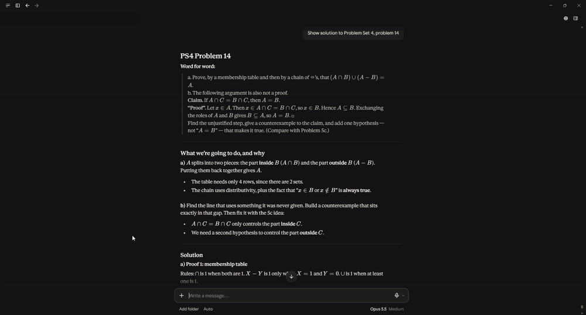
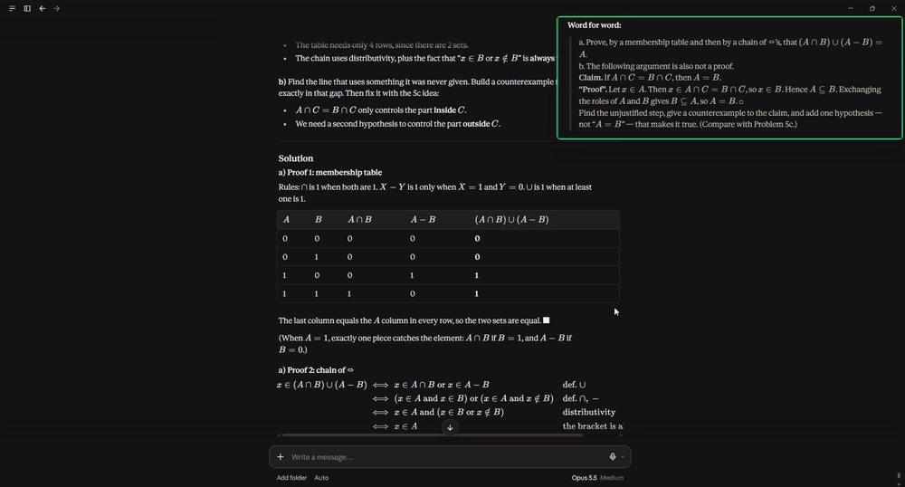

# Don't Forget

**A screenshot that follows your mouse, so you never forget the details.** Hold the mouse wheel and drag over part of the screen. That piece stays next to your cursor while you work.

## How to use it

| Do this | What happens |
|---|---|
| Hold the wheel and drag **left → right** | Snip. The note (green) follows your mouse. |
| Hold the wheel and drag **right → left** | Snip and add it (blue) to the notes already following you. |
| Quick wheel click anywhere | Drop the following notes where they are. |
| Wheel click on a note | Delete it. |
| Hold **Shift** | Freeze the following notes so you can reach them. |
| Click a note | Options: follow or pin, opacity, size, copy, delete. You can also drag it to move it and scroll on it to resize it. |

A quick wheel click still works normally in other apps when no notes are following you. Apps that use wheel-drag themselves, like SolidWorks and Blender, are left alone. You can edit that list from the tray icon under *Ignored apps…*.

## Control panel

Double-click `control.cmd` (needs PowerShell 7) to start, stop or restart the app, toggle start with Windows, change settings, or rebuild it. `control.cmd -Status` prints the current state.

## Build

Run `cargo build --release` with Rust. The `x86_64-pc-windows-gnu` toolchain works without Visual Studio. Settings are stored in `%APPDATA%\DontForget\settings.ini`.

## Requirements

- **System:** Windows 10 or 11, 64-bit. On Windows 10, notes have square corners instead of rounded ones.
- **Mouse:** any mouse with a clickable scroll wheel (middle button).
- **CPU:** any 64-bit processor. It uses no CPU while idle.
- **Memory:** about 2.5 MB of RAM.
- **Disk:** a single ~400 KB `.exe`, with nothing else to install.
