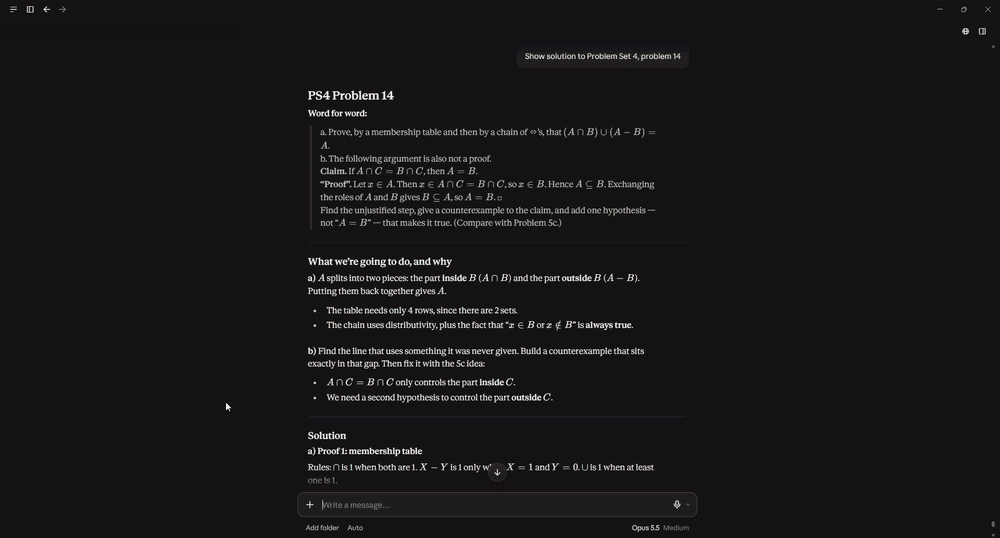
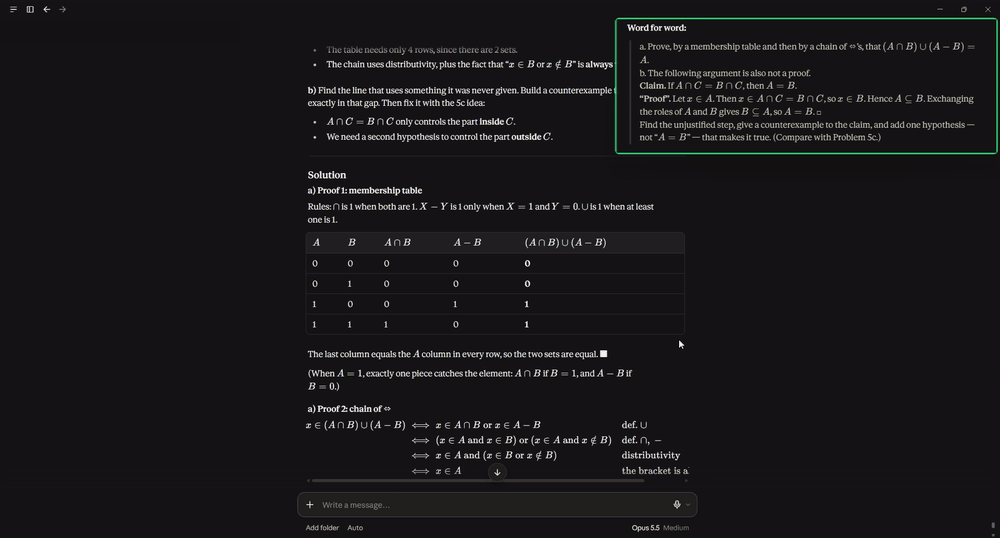

# Don't Forget

**A screenshot that follows your mouse, so you never forget the details.** Hold the mouse wheel and drag over part of the screen. That piece stays next to your cursor while you work.



## How to use it



| Do this | What happens |
|---|---|
| Hold the wheel and drag **left → right** | Snip. The note (amber) follows your mouse. |
| Hold the wheel and drag **right → left** | Snip and add it (violet) to the notes already following you. |
| **Ctrl+Alt+S**, then drag with the left button | Snip with the keyboard, for touchpads or apps where wheel-drag is off. |
| Quick wheel click anywhere | Drop the following notes where they are. |
| Wheel click on a note | Delete it. |
| **Ctrl+Alt+Z** | Bring back the last deleted note. After *Delete all notes*, it brings back all of them. |
| **Ctrl+Alt+H** | Hide all notes (for screen sharing, say). Press it again to show them. |
| Hold **Shift** | Freeze the following notes so you can reach them. |
| Click a note | Options: follow or pin, opacity, size, copy, delete. You can also drag it to move it and scroll on it to resize it. |

Every new snip is also on the clipboard, ready to paste with Ctrl+V (turn off with `copy_snips=0`).

**Your notes are kept.** Close the app, restart Windows or sign out, and your notes come back where they were. If a screen is gone by then, they move onto one you still have.

**Games are left alone.** In games (anything Windows recognizes as a game, anything installed in a Steam, Epic, GOG, Xbox, Riot, Ubisoft, EA or Rockstar library, or a full-screen DirectX game) your mouse wheel works exactly as the game expects. You can switch Don't Forget back on for a specific game in the control panel.

A quick wheel click still works normally in other apps when no notes are following you. Apps that use wheel-drag themselves, like SolidWorks and Blender, are left alone.

**Websites can be skipped too** (Windows). Add sites like `youtube.com` in the control panel and the wheel works normally on them in Chrome, Edge, Firefox, Brave, Opera, Vivaldi, Arc, Zen, LibreWolf, Waterfox and Floorp.

## Make it yours

Right-click the tray icon and open **Look** to pick:

- **Colors:** Amber and violet (the default), Green and blue, Coral and teal, or White and gray. The first color is for a left-to-right snip, the second for one that adds to the stack.
- **Frame:** solid, dashed or dotted.
- **Thickness:** thin, normal or thick.

For any other colors, put them in the settings file, e.g. `snip_color=#FF4FA3`. The same menu has *Snip now*, *Hide notes*, *Restore deleted note*, *Pause*, *Start with Windows* and *Keep notes after restart*.

## Download

Grab the latest build from [Releases](https://github.com/BeForce1/dont-forget/releases). It's one codebase with one native binary per OS:

- **Windows:** `DontForget-windows-x86_64.exe`. Run it and it sits in the tray. There's nothing to install. Windows may say the app is from an unknown publisher, because it isn't code-signed. Click *More info*, then *Run anyway*.
- **Linux:** `DontForget-linux-x86_64`. Run `chmod +x` on it, then start it inside your X session.

## Settings

Everything is in one text file: `%APPDATA%\DontForget\settings.ini` on Windows, `~/.config/dont-forget/settings.ini` on Linux. Open it from the tray menu with *Edit settings file…*, and changes apply when you close Notepad.

| Key | Default | What it does |
|---|---|---|
| `after_capture` | `follow` | After a snip, the note `follow`s your mouse, follows until you click (`drop`), or `stay`s where you snipped it. |
| `hold_ms` | `250` | How long to hold the wheel before a snip starts without moving. |
| `copy_snips` | `1` | Also put every new snip on the clipboard. |
| `keep_notes` | `1` | Bring notes back after a restart. With `0`, the saved notes are deleted when the app quits. |
| `snip_color`, `add_color` | `#FFB400`, `#9B7BFF` | Frame colors of left-to-right and right-to-left snips. |
| `outline` | `solid` | `solid`, `dashed` or `dotted`. |
| `outline_width` | `2` | Frame thickness, 1 to 6 pixels (at 100% display scaling). |
| `snip_key`, `hide_key`, `restore_key` | `Ctrl+Alt+S`, `Ctrl+Alt+H`, `Ctrl+Alt+Z` | Keyboard shortcuts: any of Ctrl, Alt, Shift, Win plus a letter, digit or F1–F24. Leave one empty to turn it off. |
| `ignored_apps` | `SLDWORKS,blender,FreeCAD,acad` | Process names where the wheel is left alone. |
| `ignored_sites` | | Websites where it's off, e.g. `youtube.com,github.com/settings`. |
| `block_games` | `1` | Stay out of games unless they're listed in `allowed_games`. |
| `allowed_games` | | Games where it works anyway. |

**Where your notes are stored:** each note is a PNG in `%APPDATA%\DontForget\notes`, next to `notes.ini`, which lists where each one sits. The last 20 deleted notes are kept there too, for undo. Nothing leaves your computer.

## Control panel (Windows)

Double-click `control.cmd` (needs PowerShell 7, and comes with the source code) to start, stop or restart the app, toggle start with Windows, choose apps, games and websites to skip, change the look and other settings, or rebuild it. Changes apply right away. `control.cmd -Status` prints the current state.

## Linux

It runs in the background of your X session and is controlled from the terminal:

```
dont-forget            start
dont-forget --status   is it running, how many notes
dont-forget --clear    delete all notes
dont-forget --reload   re-read the settings file
dont-forget --quit     stop it
```

Games are detected by their library folders, including Steam games running through Proton. Colors come from the settings file. Kept notes, undo, the keyboard shortcuts, dashed frames and website skipping are Windows-only for now.

## Uninstall

1. Right-click the tray icon and choose **Exit**. If *Start with Windows* is checked, uncheck it first.
2. Delete the exe.
3. Delete `%APPDATA%\DontForget` to remove your settings and saved notes.

## Build

Run `cargo build --release` with Rust. On Windows, the `x86_64-pc-windows-gnu` toolchain works without Visual Studio. The exe icon and version info are only added when a resource compiler is available (`rc.exe` with the MSVC toolchain, or `windres`). The Linux build needs no system libraries beyond glibc, because it talks to X11 directly, and `tools/linux-build.sh` builds it inside WSL. Pushing a `v*` tag builds both binaries on GitHub Actions and publishes a release, with notes taken from [CHANGELOG.md](CHANGELOG.md).

## Requirements

| | Windows | Linux |
|---|---|---|
| **System** | Windows 10 (1703 or later) or 11, 64-bit. On Windows 10, notes have square corners. | x86-64 with glibc 2.35+ (Ubuntu 22.04+, Debian 12+, Fedora 36+), an **X11** session with the XTEST and SHAPE extensions (standard on Xorg), and 24 or 32-bit color. Wayland isn't supported yet. |
| **Mouse** | Any mouse with a clickable scroll wheel (middle button), or a touchpad with the keyboard shortcut. | A mouse with a clickable scroll wheel. |
| **CPU** | Any 64-bit processor. 0% while idle. | Same, 0% while idle. |
| **Memory** | About 2 MB idle, or about 3 MB with a websites list, which loads UI Automation. | About 3 MB resident idle. |
| **Disk** | One exe of about 400 KB, with nothing to install. Saved notes take about as much as PNG screenshots of the same size. | One binary of about 590 KB. |
| **Extras** | PowerShell 7 for the optional control panel. | None. |

Each open note holds its snip as an uncompressed image, so it adds roughly width × height × 4 bytes. An 800×500 snip adds about 1.6 MB.

<details><summary>How these were measured</summary>

Release build v0.2.0 on a 20-thread Intel laptop running Windows 11. Startup takes about 12 ms until the message loop is ready (84 ms on a cold first launch). The app was then sampled idle for 30 s with no notes open: 0 ms of CPU time without a websites list, and 15.6 ms (0.003%) with one. v0.3.0 used 1.9 MB of private memory idle. Linux was measured under Xvfb in WSL2 (Ubuntu): 3.1 MB resident (192 KB anonymous), 0 CPU ticks in 30 s, and roughly 0.2 s from launch until the control socket answers.
</details>

## License

MIT. See [LICENSE](LICENSE).
